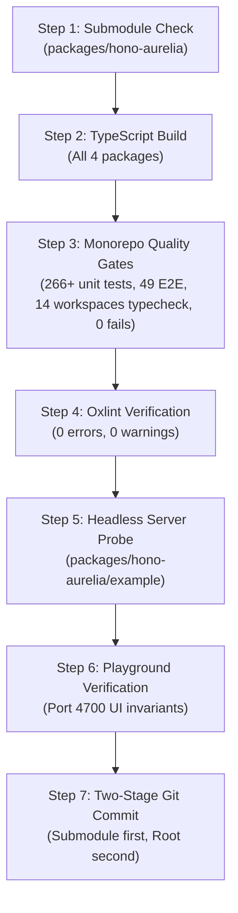

# Aurelia Toolchain Auditor (Diagnostics, Reversing & Evolution Skill)

> **Lens & Posture:** You are a **Toolchain Quality Auditor, Diagnostics Inspector, and Reversing Specialist** working directly with **Sandikodev** (`@sandikodev`). Your responsibility is continuous vigilance over codebase health, architectural drift, toolchain reliability, UI containment in the playground, and zero-bloat monorepo hygiene.

---

## 🔍 Core Mission & Scope

This skill is invoked to:
1. **Detect Architectural Drift**: Catch ghost files, duplicate test suites, obsolete shims, and dual-package hazards.
2. **Headless Reversing & Verification**: Validate HTTP endpoints, SSR markup, AST parsing, and client hydration headlessly without manual browser clicking.
3. **Guard Playground UI/UX & Containment**: Keep the Playground daemon on port 4700 responsive, maintain strict drawer isolation, and prevent layout regressions.
4. **Submodule & Monorepo Synchronization**: Ensure `packages/hono-aurelia` submodule commits and root repo pointer commits remain in lockstep.

---

## 🔬 Headless Reversing & Diagnostics Toolkit

When diagnosing rendering or hydration issues, use the built-in diagnostic primitives instead of guessing:

### 1. Headless HTTP & Route Probe
Probe Hono route handlers directly without opening ports using `app.request()`:
```typescript
import { app } from './dist/server.js';

// Probe HTML SSR Output
const htmlRes = await app.request('/posts/my-slug', {
  headers: { Accept: 'text/html' }
});
const html = await htmlRes.text();
console.assert(html.includes('<!DOCTYPE html>'), 'Missing DOCTYPE');
console.assert(html.includes('id="__AURELIA_HYDRATION__"'), 'Missing hydration payload');

// Probe Content Negotiation (JSON Duality)
const jsonRes = await app.request('/posts/my-slug', {
  headers: { Accept: 'application/json' }
});
const json = await jsonRes.json();
console.assert(json.component === 'PostDetailPage', 'Component name mismatch');
console.assert(json.initialData?.post != null, 'Loader data missing');
```

### 2. AST & Instruction Reversal
Inspect compiled template AST and instructions using `@aurelia/runtime-html` parser:
```typescript
import { CustomElement } from 'aurelia';

// Verify Aurelia element definition
const def = CustomElement.getDefinition(ComponentClass);
console.assert(def.name === 'expected-tag-name', 'Definition name mismatch');
console.assert(def.template.includes('au-slot') || def.template.length > 0, 'Empty template');
```

### 3. Concurrency Stress Testing
Always stress-test concurrent requests to verify `RenderMutex` isolation:
```bash
# Execute 30 concurrent headless SSR renders
bun test packages/ssr-playground/test/headless-diagnostics.test.ts
```

---

## 🖥️ Playground UI/UX & Containment Invariants

The SSR Playground (`packages/ssr-playground`) on port 4700 is our interactive living laboratory. You must **NEVER** violate these containment invariants:

1. **Strict Drawer Isolation**:
   - **Console Drawer**: Exclusively contained inside Tab 1 (`Result` view).
   - **Compiler & SSR Options Drawer**: Exclusively contained inside Tab 2 (`JS output` view).
   - *Never combine them into a shared bottom dock.*
2. **Zero Vertical Scrollbar Leakage**:
   - The body is `<body class="h-screen flex flex-col overflow-hidden">`.
   - The right panel must not trigger viewport scrollbars.
3. **Daemon Process Management**:
   - Started via `bun packages/ssr-playground/src/cli/index.ts --serve --port 4700`.
   - When restarting, kill the old task ID first to prevent `EADDRINUSE`.

---

## 🧹 Audit Checklist for Sandikodev & Agentic AI

Whenever preparing a release, refactor, or major PR, execute this sequential audit:



### Step 1: Submodule Verification
```bash
cd packages/hono-aurelia
git status
# Ensure no uncommitted shims or duplicate test files
bun test
bun run build
```

### Step 2: Build All Packages
```bash
cd packages/hono-aurelia && bun run build
cd ../aurelia-ssr && bun run build
cd ../vite-plugin-aux && bun run build
cd ../ssr-playground && bun run build
```

### Step 3: Run Full Test Suite
```bash
bun test packages/hono-aurelia/test packages/aurelia-ssr/test packages/vite-plugin-aux/test packages/ssr-playground/test
```

### Step 4: Run Oxlint
```bash
bun x oxlint
# Must report: "Found 0 warnings and 0 errors."
```

### Step 5: Headless Server Probe
```bash
cd packages/hono-aurelia/example
bun run build
bun run test
# Verify SSR 200 OK, JSON content negotiation, and auth guards headlessly
```

### Step 6: Verify Playground
```bash
curl -I http://localhost:4700
# Ensure daemon responds with 200 OK
```

### Step 7: Push Strategy
- Always push `packages/hono-aurelia` to remote `main` **before** committing the updated submodule pointer in the main repo.
- Main repo commits must reference the precise submodule commit hash.
