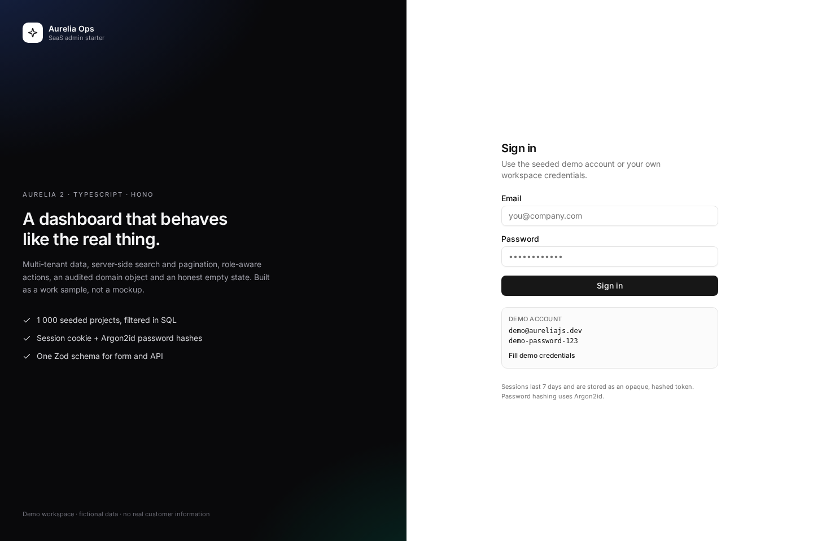
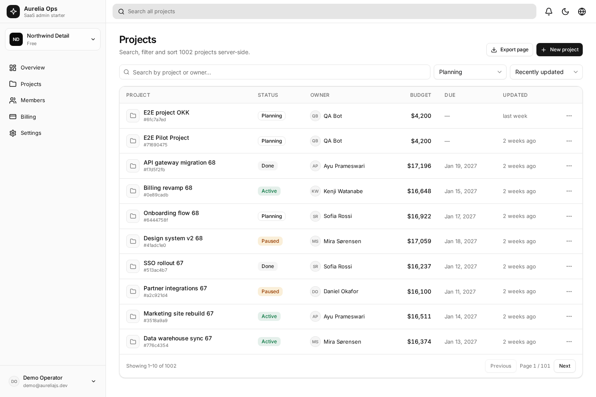
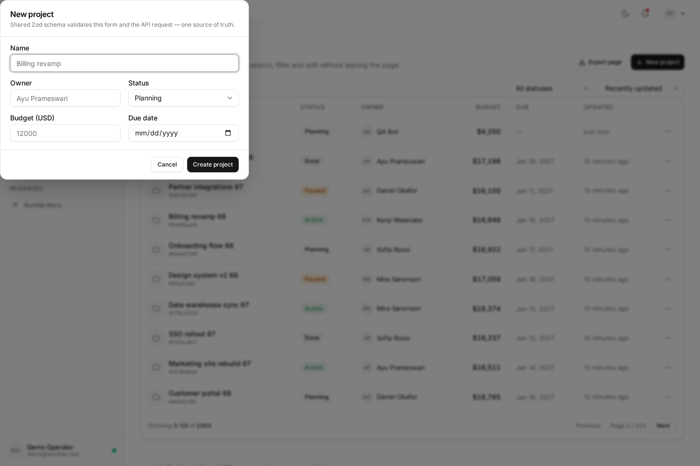

<div align="center">

# ⚡ Aurelia 2 Enterprise Ecosystem

**Next-Generation Fullstack Monorepo: Hono Edge SSR, `.aux` Single-File Components, Resumable Hydration, Interactive Developer Playground & Production Multi-Tenant SaaS.**

[](https://aurelia.io)
[](https://hono.dev)
[](https://www.typescriptlang.org)
[](https://vitejs.dev)
[](https://tailwindcss.com)
[](https://bun.sh)
[](https://oxc.rs)
[](LICENSE)

<p align="center">
  <a href="#-monorepo-packages--architecture">Packages</a> •
  <a href="#-interactive-ssr-playground">Playground</a> •
  <a href="#-aurelia-in-html-aux-single-file-components">.aux SFC</a> •
  <a href="#-enterprise-multi-tenant-saas">SaaS Dashboard</a> •
  <a href="#-architectural-manifestos">Research Manifestos</a> •
  <a href="#-quick-start">Quick Start</a>
</p>

</div>

---

## 🌟 Executive Overview

Aurelia 2 combines **Direct-DOM execution (zero Virtual DOM penalty)** with pure **TypeScript class semantics** and **TC39 Stage 3 standard decorators**. However, modern fullstack engineering demands more: edge-native Server-Side Rendering (SSR), intuitive Single-File Component (SFC) developer experience, resumable hydration, and production-tested patterns.

This monorepo serves as the definitive reference and innovation lab:
1. **Edge SSR Engine**: First-class server-side rendering for Hono runtimes (Cloudflare Workers, Deno, Bun, Fastly, Node.js).
2. **`.aux` Single-File Components**: Unifying templates, TypeScript logic, and scoped CSS with zero runtime tax.
3. **Interactive Developer Playground**: SvelteKit-style live compiler, AST visualizer, and live hydration preview.
4. **Production Multi-Tenant SaaS**: Audited, end-to-end multi-tenant dashboard with Argon2id session auth, PostgreSQL, Drizzle ORM, and Stripe Billing.

---

## 📦 Monorepo Packages & Architecture

```
aureliajs/
├── packages/
│   ├── hono-aurelia-ssr/     # Official Hono SSR & Client Hydration Engine
│   ├── vite-plugin-aux/      # Vite compiler for .aux Single-File Components
│   ├── vscode-aux/           # VS Code Language Extension for .aux SFCs
│   ├── ssr-playground/       # Interactive Web GUI & TUI SSR Inspector
│   └── shared/               # Shared Zod schemas, DTOs & plan entitlements
├── apps/
│   ├── web/                  # Multi-Tenant Client SPA (Aurelia 2 + Tailwind 4)
│   └── api/                  # High-performance REST Backend (Hono + Drizzle)
├── docs/                     # Architectural Manifestos & System Specifications
└── e2e/                      # Playwright E2E Test Suite (Accessibility & Workflows)
```

| Package / App | Path | Description | Tech Stack | Test Status |
|---|---|---|---|---|
| **`@hono/aurelia-ssr`** | [`packages/hono-aurelia-ssr`](packages/hono-aurelia-ssr) | Subpath-isolated SSR engine for Hono with context extraction, XSS sanitization, and state hydration | Hono, Aurelia 2, JSDOM | ✅ **133 / 133 Passing** |
| **`@aureliajs/vite-plugin-aux`** | [`packages/vite-plugin-aux`](packages/vite-plugin-aux) | Vite transformation plugin compiling `.aux` SFCs into canonical Aurelia 2 `@customElement` classes | Vite 8, TypeScript | ✅ Verified |
| **`@aureliajs/vscode-aux`** | [`packages/vscode-aux`](packages/vscode-aux) | Official IDE extension providing syntax highlighting, template completion, and Stage 3 decorator support | VS Code API, TextMate | ✅ Packaged |
| **`@aureliajs/ssr-playground`** | [`packages/ssr-playground`](packages/ssr-playground) | Interactive Web GUI & TUI Playground with live AST/SSR inspection and 16 official canonical examples | Bun, Hono, PrismJS | ✅ **24 / 24 Passing** |
| **`Aurelia Ops Web`** | [`apps/web`](apps/web) | Enterprise multi-tenant admin dashboard with ported shadcn/ui primitives and theme tokens | Aurelia 2, Tailwind 4 | ✅ M0–M5 Complete |
| **`Aurelia Ops API`** | [`apps/api`](apps/api) | Multi-tenant REST API with Argon2id sessions, tenancy middleware, Drizzle ORM, and Stripe billing | Hono, Drizzle, Stripe | ✅ Production-Grade |
| **`@aureliajs/shared`** | [`packages/shared`](packages/shared) | Strict Zod schemas and entitlement matrices shared across web, API, and tests | Zod, TypeScript | ✅ Typechecked |

---

## 🔬 Interactive SSR Playground

Located at [`packages/ssr-playground`](packages/ssr-playground), this developer tool provides an ergonomic development environment modeled after modern reactive playgrounds:

```bash
# Launch the Web GUI Playground (Default: port 4700)
bun packages/ssr-playground/src/cli/index.ts --serve --port 4700

# Or run terminal TUI diagnostics on all fixtures
bun packages/ssr-playground/src/cli/index.ts
```

### Key Playground Capabilities:
* **Dual-Pane Resizable Interface**: Drag-to-resize split panes with zero flicker and memory-safe event handling.
* **16 Canonical Examples**: Spanning basic interpolation, reactive counters, two-way forms, value converters, binding behaviors, dependency injection, content projection, `.aux` SFCs, and zero-JS resumable hydration.
* **Aurelia 2 Component Design System**: Formal `.au-card`, `.au-tag`, `.au-box`, and button tokens guaranteeing visual and architectural consistency.
* **Multi-Tab Output Inspector**:
  * **Result**: Live hydrated preview inside an isolated security sandbox.
  * **JS Output**: Live TypeScript transpilation and AST inspection with resizable compiler options.
  * **SSR HTML**: Raw server-pre-rendered HTML output formatted with offline Prism syntax highlighting.
  * **Console Drawer**: Synchronized bi-directional runtime logs, event triggers, and diagnostics.
  * **Audit & Metrics**: TTFB, hydration payload size, and AST node counts.

---

## 🧩 Aurelia in HTML (`.aux` Single-File Components)

Developed in [`packages/vite-plugin-aux`](packages/vite-plugin-aux) and [`packages/vscode-aux`](packages/vscode-aux), `.aux` introduces modern SFC ergonomics to Aurelia 2 while maintaining strict compliance with TC39 Stage 3 standards and Direct-DOM performance:

```html
<!-- Example: counter-widget.aux -->
<template>
  <div class="au-card">
    <div class="au-card-header">
      <h3 class="au-card-title">${title}</h3>
      <span class="au-tag au-tag-cyan">.aux SFC</span>
    </div>

    <div class="au-card-body">
      <div class="flex items-center justify-between gap-4">
        <button type="button" class="btn-increment" click.trigger="increment()">
          Count: ${count}
        </button>
        <span class="text-xs font-mono font-semibold text-cyan-400">
          State: ${count > 10 ? 'High' : 'Normal'}
        </span>
      </div>
    </div>
  </div>
</template>

<script lang="ts">
export default class CounterWidget {
  title = 'Aurelia in HTML';
  count = 10;

  increment() {
    this.count++;
  }
}
</script>

<style scoped>
.btn-increment {
  padding: 0.375rem 0.875rem;
  background-color: #0284c7;
  color: #ffffff;
  border-radius: 0.25rem;
  font-size: 0.75rem;
  font-weight: 500;
  cursor: pointer;
  border: none;
  transition: background-color 0.15s ease-in-out;
}
.btn-increment:hover {
  background-color: #0369a1;
}
</style>
```

---

## 🏢 Enterprise Multi-Tenant SaaS

A production-shaped SaaS admin dashboard with real APIs, 1 000 seeded database records, server-side filtering, session authentication, and Stripe payments.

<div align="center">



| Projects Table | Stripe Billing & Customer Portal |
| :---: | :---: |
|  |  |

| Members & Magic Link Invites | Native `<dialog>` CRUD |
| :---: | :---: |
|  |  |

</div>

### Production Capabilities:
* **Tenancy Middleware Seam**: Centralized in [`apps/api/src/middleware/tenant.ts`](apps/api/src/middleware/tenant.ts). Handlers cleanly access `tenantOf(c)` with verified workspace and role permissions (`owner`, `admin`, `member`).
* **Session Auth**: HttpOnly cookies with Argon2id passwords, SHA-256 hashed session tokens, and zero-flicker client boot.
* **Stripe Billing Integration**: Hosted Checkout Sessions, Customer Portal self-service, and idempotent signature-verified webhooks (`stripe_events.id`).
* **Ported shadcn/ui Primitives**: Button, Input, Select, Dialog, Card, Badge, Skeleton, Alert, Avatar, and Toaster adapted for Aurelia 2.
* **Deterministic Fallback**: If the API is offline, the web shell automatically falls back to sample mock data with an informative banner.

---

## 📚 Architectural Manifestos & Research

This monorepo documents in-depth philosophical and technical research exploring the evolution of the web substrate:

* 📄 **[The Resumable Frontier](docs/the-resumable-frontier.md)** — *Manifesto Rekayasa Radikal Aurelia 2, Svelte DX, Hono, dan Qwik*: Blueprint for `.aux` Single-File Components, 3-layer responsibility scoping, and exploring Qwik-style resumability on top of Aurelia's Direct-DOM architecture.
* 📄 **[The Angular-Aurelia Heritage](docs/the-angular-aurelia-heritage.md)** — *Sejarah, Semantik, dan Rekonsiliasi Mental Model Frontend*: Understanding why Aurelia feels foreign to developers from React/Vue unless familiar with Angular, uncovering the historical collaboration between Rob Eisenberg and Google in 2014, and tracing the path to modern signals.
* 📄 **[The Web Substrate Paradox](docs/the-javascript-fallacy.md)** — *Anatomi Kelahiran Prematur JavaScript, Ilusi TypeScript, dan Kerendahan Hati terhadap Bahasa Sistem Modern*: Critical dissection of why raw JS is not a technological trophy compared to Go, Rust, Nim, and Zig, and why strict typing and memory discipline are vital.
* 📄 **[The Reactive Continuum](docs/the-reactive-continuum.md)** — Architectural matrix comparing React, Vue, Solid, Angular, Svelte, Astro, Qwik, and Aurelia 2 across runtime taxes, change detection, and execution lifecycles.
* 📄 **[Production Architecture & Security](docs/architecture.md)** — Comprehensive technical specifications for multi-tenant isolation, state hydration, and Stripe integration.

---

## 🚀 Quick Start

### Prerequisites
* **Node.js**: `≥ 22.12.0` or **Bun**: `≥ 1.2.0`
* **Package Manager**: `pnpm ≥ 11`
* **Docker**: (for PostgreSQL container)

### 1. Multi-Tenant SaaS Setup
```bash
# Clone the repository
git clone git@github.com:sandikodev/aureliajs.git
cd aureliajs

# Setup environment variables
cp .env.example .env

# Install dependencies
pnpm install

# Start Postgres and run migrations
pnpm db:up
pnpm db:migrate
pnpm db:seed       # Seeds Northwind Studio with 4 members and 1 000 projects

# Run Web & API concurrently
pnpm dev           # Web on :4600, API on :4601
```

* **Web Application**: [`http://localhost:4600`](http://localhost:4600)
* **API Health Check**: [`http://localhost:4601/health`](http://localhost:4601/health)
* **Demo Credentials**: `demo@aureliajs.dev` / `demo-password-123`

### 2. SSR Playground Setup
```bash
# Launch the interactive SSR Playground web dashboard
bun packages/ssr-playground/src/cli/index.ts --serve --port 4700

# Open in browser
open http://localhost:4700
```

---

## 🧪 Quality Gates & Verification

Every component and adapter in this monorepo is backed by automated tests:

```bash
# 1. Typecheck the entire monorepo
pnpm typecheck

# 2. Run lightning-fast linting with Oxlint (0 warnings / 0 errors)
pnpm lint

# 3. Test @hono/aurelia-ssr unit suite (133 tests)
bun test packages/hono-aurelia-ssr

# 4. Test SSR Playground compiler & hydration suite (24 tests)
bun test packages/ssr-playground

# 5. Execute Playwright E2E suite
pnpm exec playwright test
```

---

## 📄 License

Open-source licensed under the [MIT License](LICENSE).  
Created and maintained by [Sandiko (@sandikodev)](https://github.com/sandikodev).
