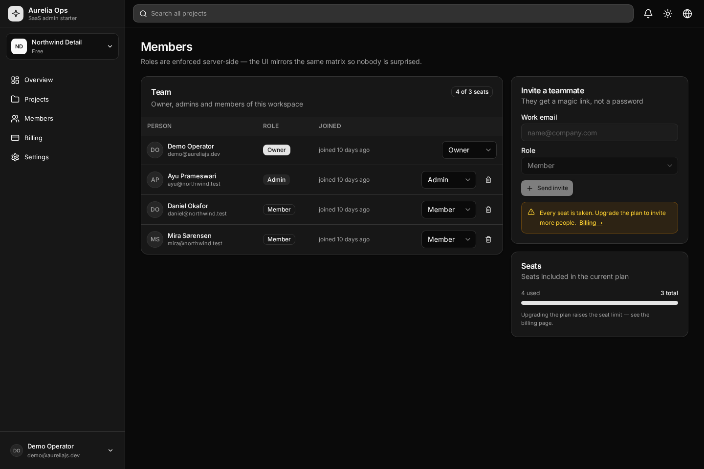
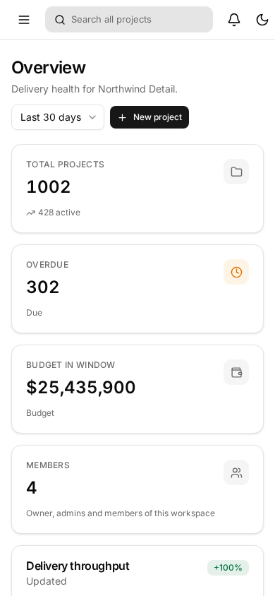

<div align="center">

# ⚡ Aurelia 2 Enterprise Ecosystem & Fullstack Portfolio

**The Definitive Fullstack Track Record & Open-Source Engineering Lab by Sandiko ([@sandikodev](https://github.com/sandikodev))**

*A production-grade Multi-Tenant SaaS showcase, Edge SSR engines, `.aux` Single-File Components, and upstream meta-framework sub-modules.*

[](https://aurelia.io)
[](https://hono.dev)
[](https://www.typescriptlang.org)
[](https://vitejs.dev)
[](https://tailwindcss.com)
[](https://bun.sh)
[](apps/web/test)
[](https://oxc.rs)
[](LICENSE)

<p align="center">
  <a href="#-author-preface--the-two-pillars">Author Preface</a> •
  <a href="#-the-architectural-paradigm-aurelia--angular-vs-react-and-vue">Aurelia vs React/Vue</a> •
  <a href="#-pillar-1-personal-showcase-saas-application-apps">Showcase SaaS App</a> •
  <a href="#-pillar-2-upstream-open-source-framework-packages-packages">Upstream Packages</a> •
  <a href="#-interactive-developer-playground">Playground</a> •
  <a href="#-architectural-manifestos--research">Manifestos</a> •
  <a href="#-quick-start">Quick Start</a>
</p>

</div>

---

## 🧭 Author Preface: The Two Pillars of this Monorepo

Welcome! This repository is my comprehensive engineering track record and research lab in the modern **Aurelia 2** ecosystem.

To ensure clarity for engineers, engineering leaders, and open-source contributors exploring this repository, the monorepo is built on **two distinct pillars with unambiguous boundaries**:

```
                                 ┌───────────────────────────────────────────────┐
                                 │                   aureliajs                   │
                                 │      SANDIKODEV'S FULLSTACK PORTFOLIO         │
                                 └───────────────────────┬───────────────────────┘
                                                         │
                    ┌────────────────────────────────────┴────────────────────────────────────┐
                    │                                                                         │
                    ▼                                                                         ▼
┌───────────────────────────────────────┐                                 ┌───────────────────────────────────────┐
│               PILLAR 1:               │                                 │               PILLAR 2:               │
│        SHOWCASE SAAS APPLICATION      │                                 │      UPSTREAM OPEN-SOURCE PACKAGES    │
│               (apps/)                 │                                 │              (packages/)              │
├───────────────────────────────────────┤                                 ├───────────────────────────────────────┤
│ • apps/web: Multi-Tenant SPA (Aurelia │                                 │ • @aureliajs/ssr: Edge SSR & Hydrator │
│   2, Tailwind v4, .aux SFCs)          │                                 │ • @hono/aurelia: Hono SSR Adapter     │
│ • apps/api: Enterprise REST Backend   │                                 │ • @aureliajs/islands: Zero-JS Islands │
│   (Hono, Drizzle ORM, PostgreSQL)     │                                 │ • @aureliajs/bridge: Polyglot Interop │
│ • apps/shared: SaaS Domain Contracts  │                                 │ • @aureliajs/vite-plugin-aux: SFC     │
│                                       │                                 │ • ssr-playground: Interactive Web GUI │
├───────────────────────────────────────┤                                 ├───────────────────────────────────────┤
│ 👉 ROLE: My personal end-user SaaS    │                                 │ 👉 ROLE: Decoupled infrastructure     │
│    portfolio showing how to build     │                                 │    contributions created to advance   │
│    production systems with Aurelia 2. │                                 │    Aurelia 2 for the global community.│
└───────────────────────────────────────┘                                 └───────────────────────────────────────┘
```

> [!IMPORTANT]
> **Strict Separation of Concerns**:
> * **`apps/` is an end-user application portfolio** — it is not a library. It proves architectural rigor in a fullstack SaaS context (multi-tenancy, RBAC, session auth, PostgreSQL queries, Stripe billing).
> * **`packages/` is a suite of reusable libraries** — they are published/publishable open-source sub-modules. They never import from `apps/` and solve framework-level challenges (SSR, island hydration, compiler tooling, foreign framework bridging).

---

## 🧠 The Architectural Paradigm: Aurelia & Angular vs. React and Vue

### 1. The 2017 to 2026 Journey
When I first learned Aurelia back in 2017 (the Aurelia 1 era), I did not yet fully grasp the profound discipline it offered compared to AngularJS (v1.x). At that time, AngularJS was plagued by `$scope`, dirty-checking `$digest` loops that degraded with thousands of watchers, and complex directive configurations. Aurelia 1—created by Rob Eisenberg after departing the Angular 2 core team—pioneered clean ES6 classes, standard TC39 decorators, and two-way property observers without dirty checking.

Returning to Aurelia 2 after years in modern frontend development brought a powerful realization:
**The world of Aurelia and Angular cannot be compared "apple-to-apple" with the cultures of React, Vue, or Svelte.**

```
┌──────────────────────────────────────────────────┬──────────────────────────────────────────────────┐
│      THE REACT / VUE / SVELTE TRADITION          │         THE AURELIA / ANGULAR TRADITION          │
│            (Functional / Reactive Glue)          │           (Enterprise Clean Engineering)         │
├──────────────────────────────────────────────────┼──────────────────────────────────────────────────┤
│ • Mental Model: Re-render closures & Hooks       │ • Mental Model: Stateful ViewModels & Direct DOM │
│ • State: Ad-hoc glue (Redux, Zustand, Pinia)     │ • Architecture: Inversion of Control & native DI │
│ • Reactivity: Hook dependencies & compiler magic │ • Reactivity: Native property observers (Direct) │
│ • Styling: Third-party utility glue (cva, clsx)  │ • Styling: Native template class bindings        │
│ • Long-term DX: High churn, glue-code fatigue    │ • Long-term DX: Enterprise stability, low debt   │
└──────────────────────────────────────────────────┴──────────────────────────────────────────────────┘
```

### 2. Why Aurelia 2 Excels in Enterprise Architecture
* **Direct-DOM (Zero Virtual DOM Tax)**: React re-invokes render functions and diffs Virtual DOM trees in memory. Aurelia observes properties directly on the live DOM with near-zero overhead.
* **Inversion of Control (IoC) & Dependency Injection**: Services (`AuthService`, `I18nService`, `ToastService`) are clean, injectable classes resolved via `@resolve` or constructors. No context providers or prop-drilling.
* **Pure TypeScript Class Semantics**: A component is an authentic, stateful TypeScript class (`ViewModel`) paired with an HTML template (`View`). Business logic remains clean, testable TypeScript; templates remain declarative HTML.
* **Elimination of React Glue Code**: In this repository, we purged `class-variance-authority`, `clsx`, and `tailwind-merge` in favor of native Aurelia 2 bindings (`class="${active ? 'bg-primary' : ''}" & debounce:300`), removing bundle weight while improving readability.

📖 *Deep dive into history and semantics: [The Angular-Aurelia Heritage: Sejarah, Semantik, dan Rekonsiliasi Mental Model Frontend](docs/essays/the-angular-aurelia-heritage.md).*

---

## 🏢 PILLAR 1: Personal Showcase SaaS Application (`apps/`)

Under [`apps/`](apps/), I built a production-shaped, multi-tenant SaaS admin platform named **Aurelia Ops**. It demonstrates how Aurelia 2 acts as the core client engine for high-performance SaaS applications.

### 📸 Visual Portfolio Showcase

<div align="center">

#### 1. Executive Overview & Metrics Dashboard (Light Theme)
*Throughput SVG sparklines, status breakdown distribution, period window switcher, and real-time audit ledger.*


---

#### 2. Projects Data Table & Native Dialog CRUD
| Projects Table (Tailwind v4 + Native Aurelia) | Accessible `<dialog>` Modal CRUD |
| :---: | :---: |
|  |  |
| *1,000 seeded projects, debounced search, status filters, deterministic sorting, and CSV formula injection mitigation.* | *HTML5 native `<dialog>` element, keyboard traps, accessible ARIA attributes, and reactive currency binding.* |

---

#### 3. Stripe Billing & Team Management (Dark Theme)
| Stripe Customer Portal & Entitlements | Team Members & Magic Link Invites |
| :---: | :---: |
|  |  |
| *Subscription tiers (Free, Pro, Scale), usage limits, hosted Stripe Checkout, and signature-verified webhook handlers.* | *Role-based permissions (Owner, Admin, Member), invite revocation, and Argon2id session authentication.* |

---

#### 4. Responsive Mobile Experience


*Full mobile responsiveness with accessible drawer navigation, touch-friendly tap targets, and responsive tables.*

</div>

### 🛠️ Architecture of `apps/`
* **`apps/web` (Client SPA)**: Built with Aurelia 2, Vite, Tailwind CSS 4, and ported `.aux` Single-File Components. Features deterministic demo fallback when the backend API is offline (`demo = true`).
* **`apps/api` (REST Backend)**: Built with Hono, Drizzle ORM, PostgreSQL, and native Bun Argon2id password hashing (`Bun.password`).
* **`apps/shared` (Domain Contract)**: Strict Zod schemas, DTOs, and plan entitlement matrices shared type-safely between client and server.
* **Strict Multi-Tenancy**: Guaranteed at the database layer via `eq(schema.projects.workspaceId, tenant.workspaceId)` on every query.

---

## 📦 PILLAR 2: Upstream Open-Source Framework Packages (`packages/`)

Under [`packages/`](packages/), I designed and maintain decoupled, reusable meta-framework packages contributed to the global Aurelia 2 community.

```
aureliajs/packages/
├── aurelia-ssr/          # Pure Aurelia 2 SSR & HTML5 JSON Hydration Engine (@aureliajs/ssr)
├── hono-aurelia/         # Thin Web-Standards Hono SSR & Actions Adapter (@hono/aurelia)
├── aurelia-islands/      # Zero-JS Selective Hydration & Native `island` Template Controller
├── aurelia-bridge/       # Polyglot Foreign Framework Interop (<au-bridge> + au-htmx)
├── vite-plugin-aux/      # .aux Single-File Component Compiler (Vite, Bun, esbuild)
├── vscode-aux/           # VS Code Language Extension for .aux SFCs
└── ssr-playground/       # Interactive Web GUI & Headless SSR Inspector (port 4700)
```

| Sub-Module | Responsibility | Tech Stack | Documentation |
|---|---|---|---|
| **`@aureliajs/ssr`** | Pure SSR renderer (`BrowserPlatform` per container, real `ISSRContext`, `SsrTemplateElementFactory`) & zero-JSDOM `./client` hydrator. | Aurelia 2, JSDOM, TypeScript | [Read Guide](packages/aurelia-ssr/README.md) |
| **`@hono/aurelia`** | Thin Web-Standards Hono adapter (`aurelia`, `aureliaAction`, `aureliaDefaults` via `WeakMap<Request>`, real `ReadableStream` SSR). | Hono 4, Web Streams | [Read Guide](packages/hono-aurelia/README.md) |
| **`@aureliajs/islands`** | Zero-JS Selective Hydration (`./server` + ~1.33 KB gz `./loader`) & native Aurelia 2 `island` Template Controller. | Web APIs, Aurelia 2 | [Read Guide](packages/aurelia-islands/README.md) |
| **`@aureliajs/bridge`** | Polyglot `<au-bridge>` (React, Vue, Svelte, Solid, Preact, Qwik) + `au-htmx` with container-scoped `IBridgeRegistry` DI. | Aurelia 2 DI, TypeScript | [Read Guide](packages/aurelia-bridge/README.md) |
| **`@aureliajs/vite-plugin-aux`** | `.aux` SFC compiler (`<script setup>`, `defineProps<T>()`, `<script server>`, `<template island="...">`, TC39 Stage 3 decorators). | Vite 8 Oxc, SWC, Bun, esbuild | [Read Guide](packages/vite-plugin-aux/README.md) |
| **`@aureliajs/vscode-aux`** | VS Code extension providing `.aux` TextMate syntax highlighting and AST completions. | VS Code API | [Folder](packages/vscode-aux) |
| **`ssr-playground`** | Interactive Web GUI & headless reversing/diagnostics inspector with 16 canonical Aurelia 2 examples. | Bun, Hono, Aurelia 2 | [Folder](packages/ssr-playground) |

---

## 🔬 Interactive Developer Playground

Located at [`packages/ssr-playground`](packages/ssr-playground), this developer tool provides a live reactive environment modeled after modern framework playgrounds:

```bash
# Launch the Web GUI Playground (Default: port 4700)
bun packages/ssr-playground/src/cli/index.ts --serve --port 4700

# Or run terminal TUI diagnostics on all 16 fixtures
bun packages/ssr-playground/src/cli/index.ts
```

* **16 Canonical Fixtures**: Basic interpolation, reactive counters, two-way forms, value converters, binding behaviors, dependency injection, content projection, `.aux` SFCs, and zero-JS resumable hydration.
* **Split-Pane Inspector**: Live hydrated preview inside an isolated security sandbox, TypeScript transpilation AST, server-rendered HTML, and bi-directional runtime logs.

---

## 🧩 Aurelia in HTML (`.aux` Single-File Components)

Developed in [`packages/vite-plugin-aux`](packages/vite-plugin-aux), `.aux` introduces modern Single-File Component ergonomics to Aurelia 2 while maintaining strict compliance with TC39 Stage 3 standards and Direct-DOM performance:

```html
<!-- Example: counter-widget.aux -->
<template>
  <div class="au-card">
    <div class="au-card-header">
      <h3 class="au-card-title">${title}</h3>
      <span class="au-tag au-tag-cyan">.aux SFC</span>
    </div>

    <div class="au-card-body">
      <div class="flex items-center justify-between gap-4">
        <button type="button" class="btn-increment" click.trigger="increment()">
          Count: ${count}
        </button>
        <span class="text-xs font-mono font-semibold text-cyan-400">
          State: ${count > 10 ? 'High' : 'Normal'}
        </span>
      </div>
    </div>
  </div>
</template>

<script lang="ts">
export default class CounterWidget {
  title = 'Aurelia in HTML';
  count = 10;

  increment() {
    this.count++;
  }
}
</script>

<style scoped>
.btn-increment {
  padding: 0.375rem 0.875rem;
  background-color: #0284c7;
  color: #ffffff;
  border-radius: 0.25rem;
  font-size: 0.75rem;
  font-weight: 500;
  cursor: pointer;
  border: none;
  transition: background-color 0.15s ease-in-out;
}
.btn-increment:hover {
  background-color: #0369a1;
}
</style>
```

---

## 📚 Architectural Manifestos & Research

This monorepo documents in-depth philosophical and technical research exploring the evolution of the web substrate:

* 📚 **[Documentation & Architecture Index](docs/README.md)** — Master navigation index across all monorepo architectural tiers.
* 🏛️ **[Master Architectural Blueprint](docs/ARCHITECTURAL-STUDY.md)** — Production 4-Tier Decoupled Suite: `@aureliajs/bridge`, `@aureliajs/islands`, `@aureliajs/ssr`, and `@hono/aurelia`.
* 📄 **[The Angular-Aurelia Heritage](docs/essays/the-angular-aurelia-heritage.md)** — *Sejarah, Semantik, dan Rekonsiliasi Mental Model Frontend*: Why Aurelia feels foreign to developers from React/Vue unless familiar with Angular, uncovering the historical collaboration between Rob Eisenberg and Google in 2014, and tracing the path to modern signals.
* 📄 **[The Resumable Frontier](docs/essays/the-resumable-frontier.md)** — *Manifesto Rekayasa Radikal Aurelia 2, Svelte DX, Hono, dan Qwik*: Blueprint for `.aux` Single-File Components, 3-layer responsibility scoping, and exploring Qwik-style resumability on top of Aurelia's Direct-DOM architecture.
* 📄 **[The Web Substrate Paradox](docs/essays/the-javascript-fallacy.md)** — *Anatomi Kelahiran Prematur JavaScript, Ilusi TypeScript, dan Kerendahan Hati terhadap Bahasa Sistem Modern*: Critical dissection of raw JS and why strict typing and memory discipline are vital.
* 📄 **[The Reactive Continuum](docs/essays/the-reactive-continuum.md)** — Architectural matrix comparing React, Vue, Solid, Angular, Svelte, Astro, Qwik, and Aurelia 2 across runtime taxes, change detection, and execution lifecycles.
* 📄 **[Production Architecture & Security](docs/architecture.md)** — Technical specifications for multi-tenant isolation, state hydration, and Stripe integration.

---

## 🚀 Quick Start

### Prerequisites
* **Bun**: `≥ 1.2.0` (package manager, runtime, bundler & native test runner)
* **Docker**: (for PostgreSQL database)

### Option A: Launching the SaaS Showcase Application (`apps/`)
```bash
# Clone repository
git clone git@github.com:sandikodev/aureliajs.git
cd aureliajs

# Setup environment variables
cp .env.example .env

# Install dependencies
bun install

# Start Postgres and run migrations
bun run db:up
bun run db:migrate
bun run db:seed       # Seeds Northwind Studio with 4 members and 1 000 projects

# Run Web & API concurrently
bun run dev           # Web on :4600, API on :4601
```

* **Web Application**: [`http://localhost:4600`](http://localhost:4600)
* **API Health Check**: [`http://localhost:4601/health`](http://localhost:4601/health)
* **Demo Credentials**: `demo@aureliajs.dev` / `demo-password-123`

### Deploying `apps/` to Vercel + Neon

The SaaS app is deployed as **one Vercel project**: the Vite SPA is served statically from
`apps/web/dist`, while `api/index.ts` runs the whole Hono app as a single Bun Function against Neon
Postgres. The browser only ever talks to one origin, so the session
cookie stays first-party.

```bash
vercel link --scope sandikodev --project aureliajs
vercel install neon --name aureliajs-db          # injects DATABASE_URL
DATABASE_URL='<direct-neon-url>' bun run --filter @aureliajs/api db:migrate:prod
vercel --prod
```

Project settings: **Root Directory** `.`, **Install** `bun install --frozen-lockfile`,
**Build** `bun run build`, **Output** `apps/web/dist`. Set `WEB_ORIGIN`, `NODE_ENV=production`,
`TRUST_PROXY=1`, `APP_VERSION`, and the Stripe secrets/price IDs in the Vercel dashboard.
Register `https://<project>.vercel.app/api/billing/webhook` in Stripe for webhooks.

**Live deployment:** [https://aureliajs.vercel.app](https://aureliajs.vercel.app)
(demo login: `demo@aureliajs.dev` / `demo-password-123`).

Verify the live deployment with `bun run smoke:live` (read-only) or, with
`NEON_DIRECT_URL`, `STRIPE_WEBHOOK_SECRET` and `LIVE_WRITE=1`, the full 39-check suite that also
exercises writes and signed Stripe webhooks and cleans up after itself.

Full details — including the pooled-vs-direct connection strings, env table, third-party status
and smoke tests — are in
[`docs/architecture.md`](docs/architecture.md#deploying-it-vercel-functions--neon).

> The Cloudflare Worker example (`aurelia-hono-ssr`) is a separate SSR reference app under
> `packages/hono-aurelia/example`, not the deployment target for `apps/`.

### Option B: Launching the Framework SSR Playground (`packages/`)
```bash
# Launch the interactive SSR Playground web dashboard
bun packages/ssr-playground/src/cli/index.ts --serve --port 4700

# Open in browser
open http://localhost:4700
```

---

## 🧪 Testing Machines & Quality Rigor

Every layer of this codebase is backed by automated tests, rejecting superficial mock reports in favor of real runtime and DOM assertions:

```bash
# 1. Typecheck all workspaces (100% strict TypeScript across 14 workspaces)
bun run typecheck

# 2. Fast linting with Oxlint (0 warnings / 0 errors)
bun run lint

# 3. Full test suites (229 tests passing, 1,367 assertions across 39 files)
bun run test

# 4. Terminal DevTools & JSDOM Aurelia 2 live hydration emulator
bun run emulate

# 5. Playwright E2E accessibility suite (WCAG AA/AAA)
bun run test:e2e
```

---

## 📄 License

Open-source licensed under the [MIT License](LICENSE).  
Created, designed, and maintained by [Sandiko (@sandikodev)](https://github.com/sandikodev).
