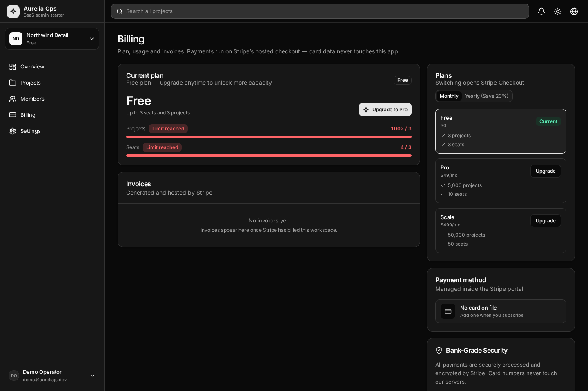

<div align="center">

# ⚡ Aurelia 2 Enterprise Ecosystem & Fullstack Portfolio

**Sandikodev's Definitive Monorepo: Production Multi-Tenant SaaS Showcase, Edge SSR Engines, `.aux` Single-File Components & Upstream Open-Source Sub-Modules.**

[](https://aurelia.io)
[](https://hono.dev)
[](https://www.typescriptlang.org)
[](https://vitejs.dev)
[](https://tailwindcss.com)
[](https://bun.sh)
[](apps/web/test)
[](https://oxc.rs)
[](LICENSE)

<p align="center">
  <a href="#-architectural-separation--repository-identity">Monorepo Identity</a> •
  <a href="#-the-architectural-paradigm-aurelia--angular-vs-react-and-vue">Aurelia vs React/Vue</a> •
  <a href="#-domain-1-production-saas-showcase-application-apps">Showcase SaaS App</a> •
  <a href="#-domain-2-upstream-open-source-framework-packages-packages">Upstream Packages</a> •
  <a href="#-interactive-ssr-playground">Playground</a> •
  <a href="#-architectural-manifestos--research">Manifestos</a> •
  <a href="#-quick-start">Quick Start</a>
</p>

</div>

---

## 🏛️ Architectural Separation & Repository Identity

This monorepo serves a dual purpose as the author's (**Sandikodev / @sandikodev**) Next-Gen Fullstack Portfolio in the Aurelia 2 ecosystem. To avoid confusion for visitors, recruiters, and open-source contributors, the codebase is segregated into **three distinct domains with crystalline boundaries**:

```
┌────────────────────────────────────────────────────────────────────────────────────────┐
│                        AURELIAJS ECOSYSTEM & PORTFOLIO MONOREPO                        │
│                (Sandikodev's Architecture Lab & Production Track Record)               │
├────────────────────────────────────────────────────────────────────────────────────────┤
│                                                                                        │
│  DOMAIN 1: PRODUCTION SAAS SHOWCASE (apps/)                                            │
│  "What can you build with Aurelia 2 in production?"                                    │
│  • apps/web: Multi-Tenant Client SPA (Aurelia 2 + Tailwind v4 + .aux SFCs)             │
│  • apps/api: Enterprise REST Backend (Hono + Drizzle ORM + PostgreSQL + Bun.password)  │
│  • apps/shared: SaaS Domain Contracts (Zod schemas, DTOs & Entitlements)               │
│  👉 Status: Personal Portfolio Fullstack Application (End-User SaaS Case Study).       │
│                                                                                        │
├────────────────────────────────────────────────────────────────────────────────────────┤
│                                                                                        │
│  DOMAIN 2: UPSTREAM OPEN-SOURCE PACKAGES (packages/)                                   │
│  "What meta-framework infrastructure does Aurelia 2 need to win the modern web?"       │
│  • @aureliajs/ssr: Pure Aurelia 2 SSR & HTML5 JSON Hydration Engine                    │
│  • @hono/aurelia: Web-Standards Hono Middleware & Action Adapter                       │
│  • @aureliajs/islands: Zero-JS Selective Hydration & Native `island` Controller        │
│  • @aureliajs/bridge: Polyglot Foreign Framework Interop (<au-bridge> React/Vue/etc)  │
│  • @aureliajs/vite-plugin-aux: .aux Single-File Component Compiler (Vite/Bun/esbuild) │
│  • ssr-playground: Interactive Web GUI & Headless Reversing Inspector                  │
│  👉 Status: Decoupled, reusable open-source libraries contributed to the ecosystem.    │
│                                                                                        │
├────────────────────────────────────────────────────────────────────────────────────────┤
│                                                                                        │
│  DOMAIN 3: VERIFICATION, ESSAYS & PLAYGROUND (e2e/ & docs/ & examples/)                │
│  • e2e/: Playwright End-to-End Suite (Accessibility WCAG AA/AAA & Core User Flows)     │
│  • docs/essays/: Deep Architectural Manifestos on History, Semantics & Reactive Shifts │
│  • examples/: Standalone Reference Apps (e.g. examples/fullstack-ssr)                  │
│                                                                                        │
└────────────────────────────────────────────────────────────────────────────────────────┘
```

> [!IMPORTANT]
> **Strict Separation Rule**: Code inside `packages/` is completely decoupled and never imports from `apps/`. Conversely, `apps/` serves as the living production proof of how these modern patterns operate in an enterprise SaaS application.

---

## 🧠 The Architectural Paradigm: Aurelia & Angular vs. React and Vue

Why does Aurelia feel profoundly natural to developers with an **Angular (or AngularJS)** background, yet cause cognitive dissonance for developers accustomed to **React, Vue, or Svelte**?

### 1. The Clean Engineering Paradigm (Aurelia & Angular)
* **Direct-DOM & Zero Virtual DOM Overhead**: Unlike React, which re-runs render functions and calculates Virtual DOM diffs on every state tick, Aurelia binds directly to the live DOM using precise property observers.
* **Inversion of Control (IoC) & Dependency Injection**: Enterprise codebases require real Dependency Injection (`@resolve`, constructor injection). In Aurelia, services (`AuthService`, `I18nService`, `ToastService`) are decoupled, testable singletons or container-scoped instances—not global state hooks.
* **Separation of Concerns (View vs. ViewModel)**: A component is a real, stateful TypeScript class instance (`ViewModel`) paired with an HTML template (`View`). Business logic remains clean POJO/TS; presentation remains declarative HTML.
* **Historical Roots (2014–2017 to Present)**: In 2014, Rob Eisenberg worked with the Google Angular team before creating Aurelia 1 to offer clean ES6 classes without the dirty-checking digest cycles and `$scope` mess of AngularJS. Today in Aurelia 2, standard TC39 decorators and compile-time optimization fulfill that original vision of native purity.

### 2. Why React/Vue Cannot Be Compared "Apple-to-Apple"
* **The React Culture**: Relies on ephemeral closures, cascading hooks (`useEffect`), and a proliferation of ad-hoc glue libraries (`class-variance-authority`, `clsx`, `tailwind-merge`, `zustand`, `redux`).
* **The Aurelia Way**: Solves styling and reactivity natively. As demonstrated in this monorepo, removing React utility libraries in favor of native Aurelia template bindings (`class="${item.active ? 'bg-primary' : ''}" & debounce:300`) eliminates bundle bloat and preserves architectural cleanliness.

📖 *For a deep historical dissection, read Sandikodev's essay: [The Angular-Aurelia Heritage: Sejarah, Semantik, dan Rekonsiliasi Mental Model Frontend](docs/essays/the-angular-aurelia-heritage.md).*

---

## 🏢 DOMAIN 1: Production SaaS Showcase Application (`apps/`)

Located under [`apps/`](apps/), this is a fully fledged, production-shaped Multi-Tenant SaaS platform demonstrating the practical application of Aurelia 2 in an enterprise fullstack context.

<div align="center">


| Projects Table (Tailwind v4 + Native Aurelia) | Stripe Billing & Customer Portal |
| :---: | :---: |
|  |  |

| Members & Magic Link Invites | Native `<dialog>` CRUD Flow |
| :---: | :---: |
|  |  |

</div>

### Key Showcase Capabilities:
* **Strict Multi-Tenancy**: Centralized in [`apps/api/src/middleware/tenant.ts`](apps/api/src/middleware/tenant.ts). Handlers cleanly access `tenantOf(c)` with verified workspace and role permissions (`owner`, `admin`, `member`). Every database query enforces tenant isolation (`eq(schema.projects.workspaceId, workspaceId)`).
* **Native Bun Password Hashing (RFC 1)**: Pure `Bun.password` Argon2id hashing in standard PHC string format—zero native C++ addon (`@node-rs/argon2`) overhead.
* **Pure Tailwind CSS 4 & Native `.aux` UI Primitives (RFC 2)**: 14 ported shadcn/ui components (`button.aux`, `badge.aux`, `alert.aux`, `card.ts`, `select.aux`, `dialog`, `toaster.aux`) without any React dependencies (`cva`, `clsx`, `tailwind-merge`).
* **Deterministic Offline Demo Fallback**: When the backend API is offline, the web application seamlessly falls back to local sample data and displays a non-intrusive demo banner—never crashing or presenting a white screen.
* **Stripe Billing Integration**: Hosted Checkout Sessions, Customer Portal self-service, and idempotent signature-verified webhooks (`stripe_events.id`).
* **Rigorous Component & Route Testing**: Backed by live JSDOM component tests in [`apps/web/test/components.test.ts`](apps/web/test/components.test.ts) and RBAC security tests in [`apps/api/test/routes.test.ts`](apps/api/test/routes.test.ts).

---

## 📦 DOMAIN 2: Upstream Open-Source Framework Packages (`packages/`)

For in-depth documentation of every ecosystem module, trade-offs, and internals, see **[`packages/README.md`](packages/README.md)**.

```
aureliajs/packages/
├── aurelia-ssr/          # Pure Aurelia 2 SSR & HTML5 JSON Hydration Engine (@aureliajs/ssr)
├── hono-aurelia/         # Thin Web-Standards Hono SSR & Actions Adapter (@hono/aurelia)
├── aurelia-islands/      # Zero-JS Selective Hydration & Native `island` Template Controller
├── aurelia-bridge/       # Polyglot Foreign Framework Interop (<au-bridge> + au-htmx)
├── vite-plugin-aux/      # .aux Single-File Component Compiler (Vite, Bun, esbuild)
├── vscode-aux/           # VS Code Language Extension for .aux SFCs
└── ssr-playground/       # Interactive Web GUI & Headless SSR Inspector (port 4700)
```

| Package | Path | Responsibility | Tech Stack | Guide |
|---|---|---|---|---|
| **`@aureliajs/ssr`** | [`packages/aurelia-ssr`](packages/aurelia-ssr) | Pure SSR renderer (`BrowserPlatform` per container, real `ISSRContext`, `SsrTemplateElementFactory`) & zero-JSDOM `./client` hydrator | Aurelia 2, JSDOM, TypeScript | [README](packages/aurelia-ssr/README.md) |
| **`@hono/aurelia`** | [`packages/hono-aurelia`](packages/hono-aurelia) | Thin Web-Standards Hono adapter (`aurelia`, `aureliaAction`, `aureliaDefaults` via `WeakMap<Request>`, real `ReadableStream` SSR) | Hono 4, Web Streams | [README](packages/hono-aurelia/README.md) |
| **`@aureliajs/islands`** | [`packages/aurelia-islands`](packages/aurelia-islands) | Zero-JS Selective Hydration (`./server` + ~1.33 KB gz `./loader`) & native Aurelia 2 `island` Template Controller | Web APIs, Aurelia 2 | [README](packages/aurelia-islands/README.md) |
| **`@aureliajs/bridge`** | [`packages/aurelia-bridge`](packages/aurelia-bridge) | Polyglot `<au-bridge>` (React, Vue, Svelte, Solid, Preact, Qwik) + `au-htmx` with container-scoped `IBridgeRegistry` DI | Aurelia 2 DI, TypeScript | [README](packages/aurelia-bridge/README.md) |
| **`@aureliajs/vite-plugin-aux`** | [`packages/vite-plugin-aux`](packages/vite-plugin-aux) | `.aux` SFC compiler (`<script setup>`, `defineProps<T>()`, `<script server>`, `<template island="...">`, TC39 Stage 3 decorators) | Vite 8 Oxc, SWC, Bun, esbuild | [README](packages/vite-plugin-aux/README.md) |
| **`@aureliajs/vscode-aux`** | [`packages/vscode-aux`](packages/vscode-aux) | VS Code extension providing `.aux` TextMate highlighting and AST template completions | VS Code API | [Folder](packages/vscode-aux) |
| **`ssr-playground`** | [`packages/ssr-playground`](packages/ssr-playground) | Interactive Web GUI & headless reversing/diagnostics inspector with 16 canonical Aurelia 2 examples | Bun, Hono, Aurelia 2 | [Folder](packages/ssr-playground) |

---

## 🔬 Interactive SSR Playground

Located at [`packages/ssr-playground`](packages/ssr-playground), this developer tool provides an ergonomic development environment modeled after modern reactive playgrounds:

```bash
# Launch the Web GUI Playground (Default: port 4700)
bun packages/ssr-playground/src/cli/index.ts --serve --port 4700

# Or run terminal TUI diagnostics on all fixtures
bun packages/ssr-playground/src/cli/index.ts
```

### Key Capabilities:
* **Dual-Pane Resizable Interface**: Drag-to-resize split panes with zero flicker and memory-safe event handling.
* **16 Canonical Examples**: Basic interpolation, reactive counters, two-way forms, value converters, binding behaviors, dependency injection, content projection, `.aux` SFCs, and zero-JS resumable hydration.
* **Multi-Tab Output Inspector**: Live hydrated preview, TypeScript transpilation, SSR HTML output, and synchronized console logs.

---

## 🧩 Aurelia in HTML (`.aux` Single-File Components)

Developed in [`packages/vite-plugin-aux`](packages/vite-plugin-aux), `.aux` introduces modern SFC ergonomics to Aurelia 2 while maintaining strict compliance with TC39 Stage 3 standards and Direct-DOM performance:

```html
<!-- Example: counter-widget.aux -->
<template>
  <div class="au-card">
    <div class="au-card-header">
      <h3 class="au-card-title">${title}</h3>
      <span class="au-tag au-tag-cyan">.aux SFC</span>
    </div>

    <div class="au-card-body">
      <div class="flex items-center justify-between gap-4">
        <button type="button" class="btn-increment" click.trigger="increment()">
          Count: ${count}
        </button>
        <span class="text-xs font-mono font-semibold text-cyan-400">
          State: ${count > 10 ? 'High' : 'Normal'}
        </span>
      </div>
    </div>
  </div>
</template>

<script lang="ts">
export default class CounterWidget {
  title = 'Aurelia in HTML';
  count = 10;

  increment() {
    this.count++;
  }
}
</script>

<style scoped>
.btn-increment {
  padding: 0.375rem 0.875rem;
  background-color: #0284c7;
  color: #ffffff;
  border-radius: 0.25rem;
  font-size: 0.75rem;
  font-weight: 500;
  cursor: pointer;
  border: none;
  transition: background-color 0.15s ease-in-out;
}
.btn-increment:hover {
  background-color: #0369a1;
}
</style>
```

---

## 📚 Architectural Manifestos & Research

This monorepo documents in-depth philosophical and technical research exploring the evolution of the web substrate:

* 📚 **[Documentation & Architecture Index](docs/README.md)** — Master navigation index across all monorepo architectural tiers.
* 🏛️ **[Master Architectural Blueprint](docs/ARCHITECTURAL-STUDY.md)** — Production 4-Tier Decoupled Suite: `@aureliajs/bridge`, `@aureliajs/islands`, `@aureliajs/ssr`, and `@hono/aurelia`.
* 📄 **[The Angular-Aurelia Heritage](docs/essays/the-angular-aurelia-heritage.md)** — *Sejarah, Semantik, dan Rekonsiliasi Mental Model Frontend*: Why Aurelia feels foreign to developers from React/Vue unless familiar with Angular, uncovering the historical collaboration between Rob Eisenberg and Google in 2014, and tracing the path to modern signals.
* 📄 **[The Resumable Frontier](docs/essays/the-resumable-frontier.md)** — *Manifesto Rekayasa Radikal Aurelia 2, Svelte DX, Hono, dan Qwik*: Blueprint for `.aux` Single-File Components, 3-layer responsibility scoping, and exploring Qwik-style resumability on top of Aurelia's Direct-DOM architecture.
* 📄 **[The Web Substrate Paradox](docs/essays/the-javascript-fallacy.md)** — *Anatomi Kelahiran Prematur JavaScript, Ilusi TypeScript, dan Kerendahan Hati terhadap Bahasa Sistem Modern*: Critical dissection of raw JS and why strict typing and memory discipline are vital.
* 📄 **[The Reactive Continuum](docs/essays/the-reactive-continuum.md)** — Architectural matrix comparing React, Vue, Solid, Angular, Svelte, Astro, Qwik, and Aurelia 2 across runtime taxes, change detection, and execution lifecycles.
* 📄 **[Production Architecture & Security](docs/architecture.md)** — Technical specifications for multi-tenant isolation, state hydration, and Stripe integration.

---

## 🚀 Quick Start

### Prerequisites
* **Bun**: `≥ 1.2.0` (package manager, runtime, bundler & native test runner)
* **Docker**: (for PostgreSQL container)

### 1. Launching the Multi-Tenant SaaS Showcase (`apps/`)
```bash
# Clone repository
git clone git@github.com:sandikodev/aureliajs.git
cd aureliajs

# Setup environment variables
cp .env.example .env

# Install dependencies
bun install

# Start Postgres and run migrations
bun run db:up
bun run db:migrate
bun run db:seed       # Seeds Northwind Studio with 4 members and 1 000 projects

# Run Web & API concurrently
bun run dev           # Web on :4600, API on :4601
```

* **Web Application**: [`http://localhost:4600`](http://localhost:4600)
* **API Health Check**: [`http://localhost:4601/health`](http://localhost:4601/health)
* **Demo Credentials**: `demo@aureliajs.dev` / `demo-password-123`

### 2. Launching the SSR Playground
```bash
# Launch the interactive SSR Playground web dashboard
bun packages/ssr-playground/src/cli/index.ts --serve --port 4700

# Open in browser
open http://localhost:4700
```

---

## 🧪 Quality Gates & Verification

Every component and adapter in this monorepo is backed by automated tests:

```bash
# 1. Build & typecheck every workspace package and app (100% strict TS)
bun run build && bun run typecheck

# 2. Run lightning-fast linting with Oxlint (0 warnings / 0 errors across 235 files)
bun run lint

# 3. Run all unit & integration tests (204 tests passing, 1,306 assertions)
bun run test

# 4. Run live JSDOM + Aurelia 2 DevTools verification emulator
bun run emulate

# 5. Execute Playwright E2E accessibility suite
bun run test:e2e
```

---

## 📄 License

Open-source licensed under the [MIT License](LICENSE).  
Created and maintained by [Sandiko (@sandikodev)](https://github.com/sandikodev).
