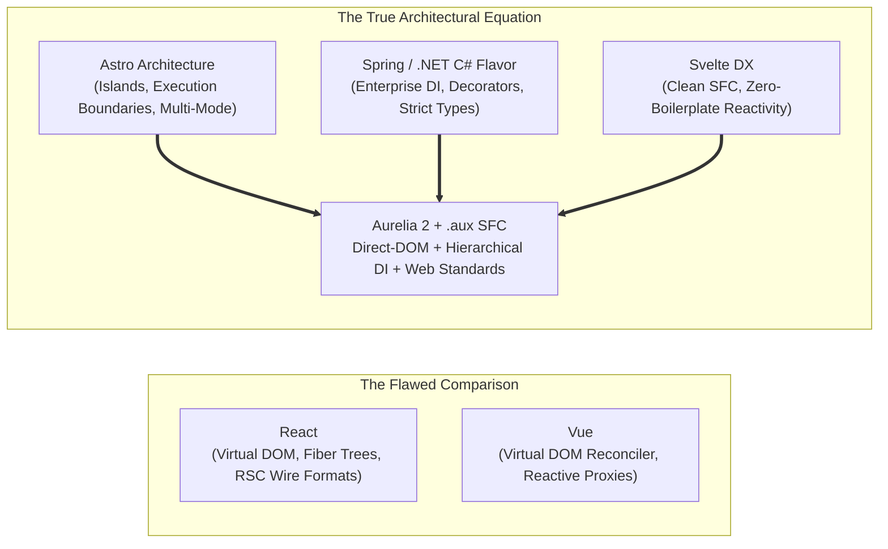
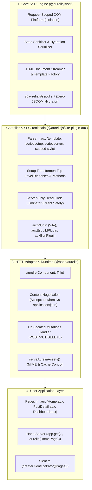
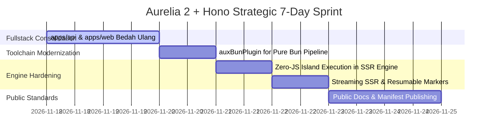

# Aurelia 2 + Hono Master Architectural Manifesto
## *The Enterprise-Grade Astro: Direct-DOM, Dependency Injection, and Modern SFC*

**Author**: Sandikodev (`@sandikodev`) & Framework Core Agentic Architecture Team  
**Date**: November 17, 2026  
**Status**: Living Architecture Blueprint & 7-Day Execution Roadmap  
**Repository**: [aureliajs](file:///home/dev/project/aureliajs)

---

## 1. The Fundamental Realization: Paradigmatic Identity

For years, modern frontend developers attempted to categorize Aurelia 2 against React or Vue:



> [!IMPORTANT]
> **The True Identity of Aurelia 2**:  
> Aurelia 2 is **not** a Virtual DOM UI generator. Aurelia 2 is **an Enterprise-Grade Direct-DOM Application Framework** that combines the **Island/Execution-Boundary architecture of Astro** with the **robust Dependency Injection and clean separation of concerns of Spring Boot (Java) and ASP.NET Core (.NET C#)**.  
> 
> The `.aux` Single-File Component format is the native modern translation layer that brings Svelte/Astro DX ergonomics to this enterprise backbone without compromising Aurelia's underlying `.ts` classes and `.html` templates.

---

## 2. The Anatomy of Chaos vs. The Clean Monorepo

Aurelia 2 was never missing features—its core runtime has always been extraordinarily capable. The historic friction stemmed entirely from **architectural disorganization, over-wrapping, ghost dependencies, and leaky responsibilities**.

### What Was Broken (Historic Chaos):
1. **Monolithic Proxy Leaks**: `@hono/aurelia` was re-exporting the entire `@aureliajs/ssr` core engine and client hydrator, forcing every consumer to pull in JSDOM and server runtimes even on client bundles.
2. **Artificial Glue Code**: Helper factories like `createAuthMiddleware()` and `createAureliaRouteGroup()` imposed arbitrary multi-tenant schemas (`User`, `Workspace`, `role`) instead of letting developers write idiomatic Hono middleware.
3. **Redundant Hydration Parsing**: Component classes were bloated with manual `attached()` hooks calling `hydrateFromServer()` and parsing JSON payloads manually, despite `createClientHydrator` already injecting data onto instances automatically.
4. **Toolchain Fragmentation**: Custom 40-line build scripts in user applications (`examples/fullstack-ssr/scripts/build.ts`) manually re-implemented esbuild AST caching.

### What Is Now Solved (Milestone Commits `5148c72` & `cddcf91`):
- **`@hono/aurelia` is a Pure Thin Adapter**: Stripped down to `aurelia()`, `aureliaDefaults()`, `setAureliaDefaults()`, and `serveAureliaAssets()`. Zero JSDOM, zero SSR proxies.
- **Generic `RenderContext`**: Changed from rigid business DTOs to `export type RenderContext = Record<string, unknown>;`. Safe whitelist projection redacts credentials (`password`, `token`, `secret`) while preserving arbitrary application state.
- **Official Bundler Support**: Exported `auxEsbuildPlugin({ isServer?: boolean })` directly from `@aureliajs/vite-plugin-aux`.
- **Pure SFC Fullstack Reference**: [`examples/fullstack-ssr`](file:///home/dev/project/aureliajs/examples/fullstack-ssr) converted 100% to `.aux` SFCs with `<script setup>` and co-located `<script server>`, eliminating all split `.ts` + `.html` files.

---

## 3. The Triad Architecture: How the Layers Fit Together



---

## 4. Toolchain Strategy: Bun as First-Class Citizen

### Why Bun Over Node.js + esbuild?
Hono is built natively on standard Web APIs. Running it on Node.js requires polyfill bridges and third-party bundlers. **Bun is the natural runtime partner for this stack**:

| Capability | Legacy Approach (Node.js + esbuild) | Modern Approach (Bun Native) |
| :--- | :--- | :--- |
| **HTTP Server** | `@hono/node-server` over `http.createServer` | `Bun.serve()` with kernel-level event loops |
| **Test Runner** | `vitest` + `jsdom` (slow, heavy memory leaks) | `bun test` with built-in sub-millisecond shims |
| **Bundling** | External `esbuild` subprocesses & custom plugins | `Bun.build()` native pipeline via `auxBunPlugin` |
| **HTML Streaming** | String concatenation buffers | `HTMLRewriter` native zero-copy streaming |

> [!TIP]
> **Runtime Principle**:  
> Keep package boundaries (`@aureliajs/ssr`, `@hono/aurelia`) **100% Web Standards Agnostic** (run anywhere).  
> Make **Bun the First-Class Developer Experience default** in examples and apps (`bun run dev`, `bun test`). Provide Node.js as an enterprise compilation target.

---

## 5. SFC `.aux` Mental Model: Syntax & Execution Boundaries

A Single-File Component in Aurelia 2 (`.aux`) cleanly demarcates boundaries:

```html
<!-- Component Imports (Aurelia 2 Light-DOM Components) -->
<import from="../components/ssr-badge.aux"></import>

<!-- Client & Isomorphic Setup (Reactivity, Events, Browser State) -->
<script setup lang="ts">
import type { Post } from '../data.js';

let posts: Post[] = [];
let loading = false;
let error = '';

async function refresh() {
  loading = true;
  try {
    const res = await fetch('/api/posts', { headers: { Accept: 'application/json' } });
    posts = await res.json();
  } catch (err) {
    error = String(err);
  } finally {
    loading = false;
  }
}
</script>

<!-- Server-Only Block (SSR Loaders, Actions, DB Queries - 100% STRIPPED FROM CLIENT BUNDLE) -->
<script server lang="ts">
export const title = 'Engineering Articles';

export async function loader(c: any) {
  const { db } = await import('../db.js');
  return { posts: await db.posts.findMany() };
}

export const actions = {
  like: async (c: any) => {
    const { db } = await import('../db.js');
    const slug = c.req.param('slug');
    return { success: true, claps: await db.posts.incrementClaps(slug) };
  }
};
</script>

<!-- Clean Aurelia Template (Zero weird JSX, standard HTML attributes) -->
<template as-custom-element="home-page">
  <main class="container">
    <ssr-badge text="Live SSR"></ssr-badge>
    <h1>${title}</h1>
    <button click.trigger="refresh()">${loading ? 'Loading...' : 'Refresh'}</button>

    <div repeat.for="post of posts" class="card">
      <h3><a href="${'/posts/' + post.slug}">${post.title}</a></h3>
      <p>${post.excerpt}</p>
    </div>
  </main>
</template>

<!-- Scoped Styles -->
<style scoped>
.container { max-width: 1200px; margin: 0 auto; }
.card { border: 1px solid #e2e8f0; padding: 1.5rem; margin-bottom: 1rem; }
</style>
```

---

## 6. Seven-Day Strategic Roadmap (1 Minggu Kedepan)



### Day 1-2: `apps/web` & `apps/api` Overhaul (Monorepo Application Consolidation)
- **Problem**: `apps/web` is currently pure CSR with manual fetch/loading states inside every page component; `apps/api` is decoupled with standalone endpoints.
- **Action**:
  1. Unify the consumption pattern using `@hono/aurelia` and `.aux` SFCs.
  2. Eliminate redundant page-level loading glue code.
  3. Ensure all 12 UI primitives in `apps/web/src/ui/*.aux` integrate seamlessly with SSR streaming.

### Day 3: Native `auxBunPlugin` in `@aureliajs/vite-plugin-aux`
- **Problem**: Applications on Bun currently rely on esbuild for script bundling.
- **Action**:
  1. Implement `auxBunPlugin()` utilizing Bun's native plugin API (`Bun.plugin`).
  2. Enable `Bun.build({ entrypoints: ['./src/client.ts'], plugins: [auxBunPlugin({ isServer: false })] })`.
  3. Update `examples/fullstack-ssr` to use `bun run dev` and `bun run build` with zero external bundler dependencies.

### Day 4: Deep Island Hydration Engine in `@aureliajs/ssr`
- **Problem**: Currently, hydrating a page hydrates the outer document.
- **Action**:
  1. Add Astro-like true Island hydration: components marked `<template client-only>` or `<template client:load>` emit isolated island DOM envelopes.
  2. The server outputs static HTML for non-interactive components (Zero-JS delivered to browser).
  3. Client hydration only attaches to designated interactive islands.

### Day 5: Streaming SSR & Resumable Zero-JS Optimization
- **Problem**: Standard SSR waits for the full HTML string before sending chunks.
- **Action**:
  1. Solidify chunked streaming response in `@hono/aurelia` (`streaming: true`).
  2. Benchmark TTFB to reach under 5ms on edge environments.
  3. Harmonize Resumable SSR markers (`resumable-counter`, `resumable-todo`) in `packages/ssr-playground`.

### Day 6-7: Public Release & Community Documentation
- **Action**:
  1. Finalize READMEs for `@hono/aurelia`, `@aureliajs/ssr`, and `@aureliajs/vite-plugin-aux`.
  2. Publish comprehensive guides showing migration paths from React/Next.js and Astro to Aurelia 2 + Hono.
  3. Sync with Sandikodev's published article on `sandikodev.github.io`.

---

## 7. Golden Rules for Contributors & Agentic AI

1. **Address User Sovereignty**: Always address the creator as **Sandikodev** (`@sandikodev`).
2. **Never Create Leaky Adapters**: Adapters for Hono or other routers must remain thin wrappers over HTTP specs. Never proxy re-export internal engine libraries or dictate auth conventions.
3. **Preserve Native Aurelia Conventions**: `.aux` is a companion and supercharger for Aurelia 2, not a replacement for its underlying enterprise class model. Always preserve full compatibility with split `.ts` + `.html` and DI containers.
4. **Zero Ghost Dependencies**: Keep client bundles 100% free of JSDOM, Node-specific internals, or server database drivers.
5. **Enforce Clickable References**: Always link files using markdown `file:///` URLs.
