# Aurelia Ecosystem Discipline & Architectural Reform Manifesto
## Resolusi Deklaratif: Mengakhiri Kekacauan, Meruntuhkan Alasan Niche Enterprise, dan Membangun Meta-Framework Aurelia 2 yang Bersih, Native, dan Robust

**Status**: Living Architecture RFC & Ecosystem Manifesto  
**Author**: Sandikodev & Antigravity  
**Target Ekosistem**: Aurelia 2, Hono, Bun, Vite, dan Komunitas Pengembang Fullstack  
**Tanggal**: 20 November 2026  

---

## 1. Kata Pengantar: Kegelisahan Otentik (The Authentic Voice)

> *"Komunitas Aurelia ini terasa sangat chaos. Sering kali ada apologia bahwa Aurelia memiliki 'niche market' sendiri sebagaimana AngularJS era lampau—hidup dalam budaya enterprise C#, .NET, dan Java Spring. Ketika dikritik soal DX yang kotor dan berbelit, muncul dalih bahwa secara pendanaan dan dukungan komunitas kita tidak apple-to-apple dengan React atau Angular.*  
>  
> *Tetapi mari kita jujur: **pendanaan dan ukuran komunitas bukan alasan (excuse) untuk tidak berdisiplin.**  
>  
> *Angular yang berakar dari budaya enterprise yang sama membuktikan keberanian revolusi total: membongkar `NgModule`, mengadopsi Signals, merilis Deferrable Views (`@defer`), dan beralih ke Vite. Svelte—yang lahir dari komunitas independen tanpa raksasa teknologi di belakangnya pada awalnya—menunjukkan kedisiplinan luar biasa saat merombak reaktivitas mereka ke Svelte 5 Runes. Vue berevolusi dari Options API ke `<script setup>`. Hono membuktikan bahwa komitmen murni pada Web Standards mampu menundukkan kompleksitas framework raksasa.*  
>  
> *Jika Aurelia ingin bertahan, dihargai, dan memimpin sebagai meta-framework kelas dunia, kita harus mendidik komunitas untuk **disiplin secara radikal**. Hentikan kode kotor, buang boilerplate yang tidak perlu, pisahkan ranah kerja compiler dan runtime, dan buat setiap package menyelesaikan urusannya sendiri secara tuntas tanpa membocorkan plumbing ke tangan pengguna."*  
> — **Sandikodev**

---

## 2. Diagnosis: Mengapa Ekosistem Aurelia Terjebak dalam Kekacauan?

Aurelia diciptakan dengan filosofi desain yang luar biasa: *Convention over Configuration*, *Direct-DOM binding* tanpa overhead Virtual-DOM, dan kepatuhan murni pada standar JavaScript (ESNext). Namun, tanpa kedisiplinan pemisahan ranah tanggung jawab (*bounded contexts*), filosofi ini justru melahirkan anomali di era web modern:

```
┌─────────────────────────────────────────────────────────────────────────────────────────────────┐
│                          DIAGNOSIS ANOMALI KULTUR ENTERPRISE AURELIA                            │
├───────────────────────────────┬─────────────────────────────────────────────────────────────────┤
│ Penyakit Arsitektural         │ Manifestasi Nyata di Lapangan                                   │
├───────────────────────────────┼─────────────────────────────────────────────────────────────────┤
│ 1. The "Clean Code" Illusion  │ Mengaku kodenya "bersih" hanya karena memisahkan file .ts dan   │
│                               │ .html, padahal developer dipaksa menulis 4 file boilerplate     │
│                               │ hanya untuk menampilkan sebuah widget sederhana.                │
├───────────────────────────────┼─────────────────────────────────────────────────────────────────┤
│ 2. The Ceremony Trap (OOP DI) │ Memaksa semua hal diselesaikan melalui Dependency Injection     │
│                               │ container yang rumit (@resolve, token registry), bahkan untuk   │
│                               │ data transfer object (DTO) sesaat di level HTTP request.        │
├───────────────────────────────┼─────────────────────────────────────────────────────────────────┤
│ 3. Script Leakage ke Userland │ Memberikan starter/example scaffold yang berisi skrip build     │
│                               │ manual (`scripts/build.ts`), mencemari project developer dengan  │
│                               │ plumbing internal yang seharusnya diselesaikan oleh framework. │
├───────────────────────────────┼─────────────────────────────────────────────────────────────────┤
│ 4. Residue & Extension Leaks  │ Mengimpor modul lokal dengan akhiran `.js` di dalam berkas TS,  │
│                               │ membingungkan developer antara ranah browser, ESM, dan bundler. │
├───────────────────────────────┼─────────────────────────────────────────────────────────────────┤
│ 5. Boundary Blurring          │ Tidak ada batas tegas antara apa yang menjadi tugas compiler,   │
│                               │ runtime rendering DOM, HTTP adapter, dan client hydration.      │
└───────────────────────────────┴─────────────────────────────────────────────────────────────────┘
```

---

## 3. Komparasi Referensif: Disiplin Revolusioner Framework Sebelah

Tidak ada alasan bagi Aurelia untuk bersembunyi di balik tameng *"enterprise niche"*. Mari kita pelajari bagaimana framework modern mengelola ekosistem mereka:

```mermaid
flowchart TD
    subgraph Angular["Angular Modern Renaissance"]
        A1["Hapus birokrasi NgModule"] --> A2["Signals replaces Zone.js"]
        A2 --> A3["@defer Deferrable Views (Islands)"]
        A3 --> A4["Vite + esbuild Compiler"]
    end

    subgraph Svelte["Svelte 5 Radical Evolution"]
        S1["Buang reactive declaration $:"] --> S2["Svelte Runes ($state, $derived)"]
        S2 --> S3["Zero-Runtime Store Overhead"]
        S3 --> S4["SvelteKit sebagai Thin HTTP Adapter"]
    end

    subgraph Hono["Hono Web Standards Pragmatism"]
        H1["No Virtual DOM overhead"] --> H2["Universal Web Standards (Request/Response)"]
        H2 --> H3["@hono/react-renderer (Thin Middleware)"]
        H3 --> H4["Edge & Serverless Native"]
    end

    subgraph AureliaReform["Aurelia 2 Reformasi Modern"]
        AR1[".aux SFC Compiler (Script Setup)"] --> AR2["@hono/aurelia (Zero-Boilerplate Routing)"]
        AR2 --> AR3["@aureliajs/islands (Zero-JS Selective Hydration)"]
        AR3 --> AR4["@aureliajs/bridge (Zero-Glue Polyglot Interop)"]
    end
```



### 1. Pembelajaran dari Angular (Enterprise Renaissance)
Angular menyadari bahwa developer enterprise sekalipun sudah lelah dengan birokrasi `NgModule`, lambatnya `Zone.js`, dan konfigurasi Webpack yang membengkak. Mereka tidak berkompromi: **mereka mereformasi sistem reaktivitas menjadi Signals dan meluncurkan Deferrable Views (`@defer`)**. Ini adalah pengakuan bahwa Islands Architecture dan performa instan adalah keharusan mutlak.

### 2. Pembelajaran dari Svelte (Compiler Supremacy)
Svelte membuktikan bahwa inovasi tidak membutuhkan triliunan rupiah pendanaan korporat; inovasi membutuhkan **keberanian intelektual**. Ketika sistem reaktivitas lama dirasa membingungkan di skala besar, tim Svelte menciptakan *Runes*. Compiler memikul 90% beban pekerjaan agar developer menulis kode JavaScript murni tanpa upacara pemujaan syntax.

### 3. Pembelajaran dari Hono (Web Standards as Lingua Franca)
Hono tidak pernah memaksakan diri menjadi frontend framework. Hono menyediakan abstraksi HTTP tercepat di dunia yang tunduk 100% pada standar W3C. Ketika Hono dipasangkan dengan React (`@hono/react-renderer`), Hono tidak menciptakan CLI aneh-aneh—Hono hanya menyediakan middleware `c.render()` yang elegan.

---

## 4. Matriks Bounded Contexts: Tanggung Jawab Murni Tiap Packages

Agar konsumsi di tingkat aplikasi (`apps/` dan `examples/`) benar-benar bersih, setiap package di monorepo `@aureliajs` memiliki batas kedaulatan arsitektural yang tidak boleh dilanggar:

| Package | Peran & Bounded Context | Apa yang HARUS Diselesaikan Sendiri | Apa yang DILARANG Bocor ke Userland |
| :--- | :--- | :--- | :--- |
| **`@aureliajs/ssr`** | *Pure Framework-Agnostic SSR Engine* | 1. Merender ViewModel Aurelia menjadi HTML string/stream dalam virtual DOM terisolasi (LinkeDOM/JSDOM) tanpa mencemari `globalThis`.<br>2. Menghasilkan marker hidrasi (`<!--au-->`) dan payload state kebal XSS (`__AURELIA_SSR_DATA__`).<br>3. Menyediakan auto-hydrator di client (`@aureliajs/ssr/client`). | ❌ Dilarang menyentuh HTTP framework (Hono/Express).<br>❌ Dilarang melakukan parsing request URL atau header khusus server. |
| **`@hono/aurelia`** | *Thin Meta-Framework Adapter for Hono* | 1. Menyediakan `aureliaRenderer()` middleware dengan mental model setara `@hono/react-renderer`.<br>2. Menyediakan rute deklaratif `aurelia(Component)` dan mutasi `aureliaAction(Component)`.<br>3. Mengelola Web Streams streaming native.<br>4. Menyediakan compiler engine internal (`@hono/aurelia/build`) untuk bundle browser & worker. | ❌ Dilarang memaksa user membuat skrip build manual (`scripts/build.ts`).<br>❌ Dilarang membuat custom CLI baru yang menduplikasi Bun/Vite. |
| **`@aureliajs/islands`** | *Zero-JS Selective Hydration & Boundaries* | 1. Server (`./server`): Membungkus custom element ke dalam tag boundary `<tag data-au-island="visible" data-au-src="...">`.<br>2. Client (`./loader`): Menyediakan runtime micro-loader (~1.2 KB gz) berbasis `IntersectionObserver`, `mediaQuery`, dan `idle`.<br>3. Menyediakan template controller native `island="visible"`. | ❌ Dilarang memuat Aurelia core runtime ke halaman sebelum trigger interaktivitas aktif.<br>❌ Dilarang membebani client dengan overhead hidrasi penuh. |
| **`@aureliajs/bridge`** | *Universal Polyglot Micro-Frontend Interop* | 1. Menghilangkan instruksi manual dokumen Aurelia (tidak ada lagi file wrapper manual `react-wrapper.ts`).<br>2. Menyediakan custom element deklaratif `<au-bridge using="react" component.bind="..." />`.<br>3. Mengelola siklus hidup mount, unmount, dan sync reactive props dua arah secara otomatis. | ❌ Dilarang memaketkan seluruh bundle framework asing (React/Vue/Svelte) jika user hanya memakai salah satunya (wajib strict dynamic import / decoupled subpaths). |
| **`@aureliajs/vite-plugin-aux`** | *Single-File Component Compiler (.aux)* | 1. Mengompilasi `<template>`, `<script setup>`, `<script server>`, dan `<style scoped>` menjadi kelas Aurelia 2 standar.<br>2. **Dead-Code Elimination (DCE)**: Menghapus 100% blok `<script server>` dan static loader dari bundle client browser.<br>3. Scoping CSS otomatis via atribut `data-au-x`. | ❌ Dilarang menyisakan kode server di bundle client.<br>❌ Dilarang membutuhkan runtime loader terpisah di browser production. |
| **`@aureliajs/vscode-aux`** | *Developer Tooling & LSP Extension* | 1. Syntax highlighting untuk template, TypeScript setup, dan scoped style.<br>2. Autocomplete, diagnostics, dan hover hints setara Volar (Vue) dan Svelte for VSCode. | ❌ Dilarang bergantung pada konfigurasi workspace yang rumit. |
| **`ssr-playground`** | *Living Specification & Regression Sandbox* | 1. Menguji dan memvalidasi keutuhan 16+ skenario riil (data table, loop, two-way form, resumable todo, DI, au-slot). | ❌ Dilarang menjadi dependensi produksi untuk package lain. |

---

## 5. Strategi Refaktorisasi: Menjaga Backward Compatibility Tanpa Mengorbankan Clean DX

Reformasi tidak boleh menghancurkan basis kode yang sudah ada (*breaking changes*). Prinsip arsitektur berikut menjamin backward compatibility 100%:

### A. Dual-Path API: Pragmatic Functional vs Enterprise DI
Bagi pengembang berlatar belakang enterprise, injeksi ketergantungan via Container tetap didukung penuh. Namun bagi pengembang modern, parameter fungsi murni (*pure function arguments*) menjadi standar utama:

```typescript
// PATH 1: Modern Pragmatic (Zero-Ceremony — Direkomendasikan)
export class PostDetailPage {
  // c langsung diterima dari Hono Context tanpa sentuhan DI container
  static async loader(c: Context) {
    const slug = c.req.param('slug');
    return { post: await getPost(slug) };
  }
}

// PATH 2: Enterprise DI (Backward Compatible)
export class PostDetailPage {
  // Tetap didukung penuh bagi sistem arsitektur warisan
  @resolve(IHonoContext) private readonly c!: Context;
}
```

### B. Granular Subpath Exports (Anti-Bloat Protection)
Untuk mencegah bundler browser menarik library server-side (seperti LinkeDOM, JSDOM, atau modul Node.js), seluruh package wajib menerapkan pemisahan ekspor:

```json
{
  "exports": {
    ".": "./dist/index.js",
    "./server": "./dist/server.js",
    "./client": "./dist/client.js",
    "./loader": "./dist/loader.js",
    "./build": "./dist/builder.js"
  }
}
```

### C. Zero Userland Build Scripts Convention
**Hukum Mutlak Monorepo**: Tidak boleh ada lagi folder `scripts/` di dalam project aplikasi pengguna atau starter scaffold. Semua kebutuhan pembundelan diselesaikan langsung oleh Bun CLI native 1-baris atau library internal:

```json
// DI DALAM package.json APLIKASI
"scripts": {
  "dev": "bun run build:client && bun --watch src/server.ts",
  "build:client": "bun build src/client.ts --outdir public --loader .html:text --minify",
  "build": "bun run build:client && tsc --noEmit",
  "start": "bun src/server.ts"
}
```

---

## 6. Standar Kedisiplinan Ekosistem (The Aurelia 2 Discipline Codex)

Setiap kontributor, maintainer, dan pengembang di monorepo ini wajib memegang teguh 5 pilar disiplin berikut:

1. **Disiplin 1: Standar Web di Atas Upacara Adat Enterprise**  
   Prioritaskan W3C Web Standards (`Request`, `Response`, `Headers`, `ReadableStream`, `FormData`). Jangan membuat wrapper buatan sendiri jika browser/runtimes sudah menyediakannya secara native.
2. **Disiplin 2: Zero Extension Leaks**  
   Impor modul lokal di lingkungan TypeScript/Bundler modern tidak boleh menggunakan akhiran `.js` atau `.ts` (`import { App } from './app'`). Ekstensi file hanya digunakan untuk aset non-JS seperti `.html`, `.css`, dan `.aux`.
3. **Disiplin 3: Strict Execution Boundaries**  
   Kode server (database, token otentikasi rahasia, environment internal) tidak boleh bocor 1 byte pun ke client bundle. Compiler wajib memangkasnya saat build.
4. **Disiplin 4: Scaffold Minimalis (Maksimal 3 Berkas Konfigurasi)**  
   Sebuah scaffold starter yang bersih hanya boleh memiliki `package.json`, `tsconfig.json`, dan file konfigurasi runtime (`bunfig.toml` atau `vite.config.ts`). Jika membutuhkan lebih banyak file plumbing untuk sekadar berjalan, arsitekturnya dianggap cacat.
5. **Disiplin 5: Zero Excuses for Quality**  
   Besaran pendanaan atau skala komunitas bukan alasan untuk memproduksi kode kotor. Disiplin, kerapian, dan keanggunan kode adalah pilihan profesional.

---

## 7. Status Eksekusi & Bukti Monorepo Saat Ini

Seluruh prinsip dalam manifesto ini telah diimplementasikan dan diverifikasi secara riil pada branch `master`:

- **Eliminasi Build Scripts**: Folder `examples/aurelia-ssr/scripts` dan `examples/aurelia-islands/scripts` telah dimusnahkan.
- **Pembersihan Impor `.js`**: Seluruh modul pada kelima example telah bersih tanpa residu ekstensi.
- **UI/UX Modern Responsif**: Scaffold `examples/fullstack-ssr` telah memiliki arsitektur mobile-first dengan tab-bar segmented control dan canvas bacaan artikel yang mulus.
- **Integritas Monorepo 100% Green**:
  - `bun run typecheck`: 9 dari 9 workspace terkonsolidasi lulus 100% (0 errors).
  - `bun run test`: 148 automated tests pass across 27 files, 0 failed, 999 assertions.
  - `bunx oxlint .`: 0 errors pada 226 files.

---
*Dokumen ini menjadi acuan kanonikal bagi evolusi Aurelia 2 menuju meta-framework fullstack generasi berikutnya.*
