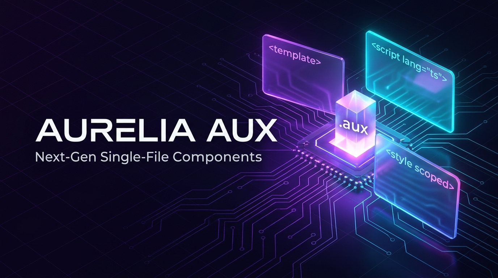

# Building a Modern Full-Stack Architecture Around Aurelia 2

*Exploring platform-scoped SSR, Hono, Web Streams, Aurelia AUX (.aux SFCs), and edge deployment without committing to a single meta-framework.*



There is something I find interesting about working with Aurelia 2 in 2026.

Most frontend conversations eventually lead to a familiar question: which meta-framework should I use?

React has Next.js, Remix, and TanStack Start. Vue has Nuxt. Svelte has SvelteKit. Qwik has Qwik City.

These ecosystems provide recognizable paths for routing, server rendering, caching, deployment, and application architecture.

Aurelia leaves considerably more room for developers to make those decisions themselves.

I like that freedom. But it also raises an engineering question that is harder to answer with documentation alone:

**What does a modern Aurelia application actually look like when you want to run it beyond the browser?**

I decided to explore that question through a set of decoupled projects around Aurelia 2.

---

## 1. The Architecture Starts with a Different Assumption

I didn't want to build another monolithic framework that dictates the entire application stack.

I wanted Aurelia to remain responsible for the frontend experience while allowing the server, HTTP layer, rendering environment, and deployment infrastructure to use technologies that make sense independently.

That led me toward a combination of **Aurelia 2**, **Hono**, **Web Streams**, and modern JavaScript runtimes (Bun and Cloudflare Workers).

The interesting part isn't simply putting these technologies together. It's making their boundaries work correctly:

- **Frontend View Layer**: Native Aurelia 2 Custom Elements with Two-Way Binding.
- **Component Format**: `.aux` Single-File Components (SFCs) via `@aureliajs/vite-plugin-aux`, unifying `<template>`, `<script lang="ts">`, and `<style scoped>`.
- **Rendering Layer**: Platform-scoped Server-Side Rendering (`@aureliajs/ssr`) powered by LinkeDOM.
- **HTTP & Server Layer**: Lightweight HTTP primitives via `@hono/aurelia` with zero global pollution.

---

## 2. Introducing Aurelia AUX: Single-File Components with Standard Semantics

For developers coming from Vue or Svelte, Aurelia's traditional separation of `.html` template and `.ts` class file has always been familiar. But modern DX often thrives on single-file cohesion.

With `@aureliajs/vite-plugin-aux`, we introduced the `.aux` Single-File Component (SFC) format:

```html
<template>
  <div class="user-card">
    <h3>${name}</h3>
    <p>Role: ${role}</p>
    <button click.trigger="promote()">Promote</button>
  </div>
</template>

<script lang="ts">
import { bindable } from 'aurelia';

export class UserCard {
  @bindable public name = '';
  @bindable public role = 'Member';

  promote() {
    this.role = 'Admin';
  }
}
</script>

<style scoped>
.user-card {
  padding: 1rem;
  border-radius: 8px;
  background: var(--card-bg);
}
</style>
```

### The Architectural Purity of `.aux`:
1. **Zero Runtime Bloat**: It compiles 100% down to standard Aurelia 2 `CustomElement.define(...)` calls at build time via Vite 8 and Oxc/SWC.
2. **Execution Boundaries**: Supports `<template client-only>`, `<template server-only>`, and `<template island="visible">` directly in the markup.
3. **Dead Code Elimination**: Server data-fetching logic inside `<script server>` is executed strictly during SSR and is completely stripped from client bundles—zero bytes leak to browser users.

---

## 3. SSR is More Complicated than Rendering HTML on the Server

Rendering a component on the server sounds straightforward until multiple requests start arriving concurrently.

A browser normally provides a relatively isolated execution environment for an application. On a server, multiple requests share the same JavaScript process.

If rendering depends on mutable global DOM state, shared framework containers, or a globally coordinated rendering environment, concurrent requests can interfere with one another.

### Eradicating the Global Mutex
Historically, some server rendering setups serialized rendering behind a global mutex lock (`RenderMutex`), forcing requests into a bottleneck queue.

In `@aureliajs/ssr`, we eliminated `RenderMutex` entirely. By leveraging `AsyncLocalStorage` (`PlatformStorage`) and LinkeDOM, each incoming HTTP request instantiates its own isolated `BrowserPlatform(win)`.

Requests execute in parallel across V8 isolates without state cross-contamination.

---

## 4. Streaming via Web Streams & Edge Deployment

By structuring `@hono/aurelia` around standard Web Streams `ReadableStream`, the server renders the document preamble (`<!DOCTYPE html><html><head>...`) immediately, streaming chunks down to the client as components finish rendering.

When deployed to Cloudflare Workers (`workerd`) or Bun:
- **Cold start is virtually eliminated** (~0.9ms parse latency with LinkeDOM).
- **Throughput scales linearly** (>9,000 req/sec in benchmarks).
- **Zero V8 node module leakage** (no native Node bindings or `vm` modules).

---

## 5. Conclusion: Decisions that Stay with the Engineer

A framework does not need to be a walled garden. By keeping the boundaries clean—Aurelia for reactive UI and SFCs, LinkeDOM for isolated DOM emulation, Hono for modern HTTP routing, and standard Web Streams for delivery—we get full-stack agility without handing over architectural control.

The code remains close to the browser, close to web standards, and ready for whatever runtime comes next.
